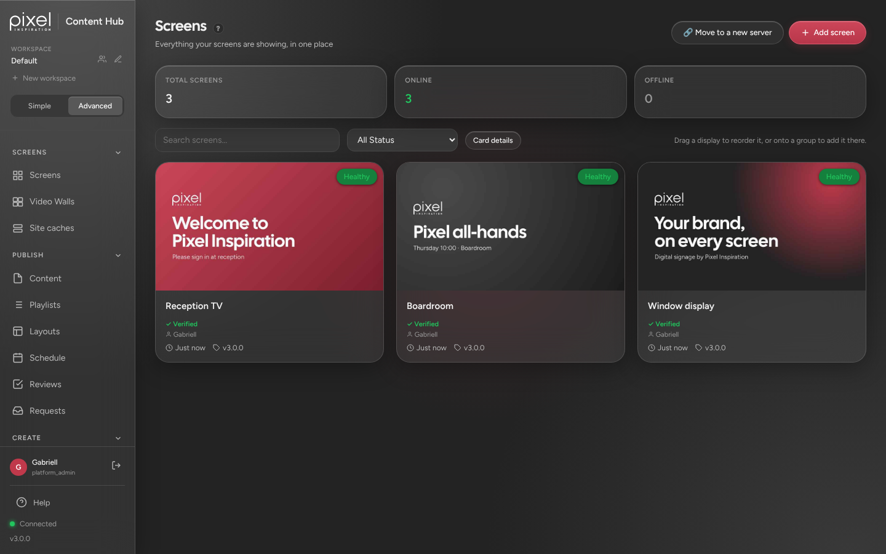
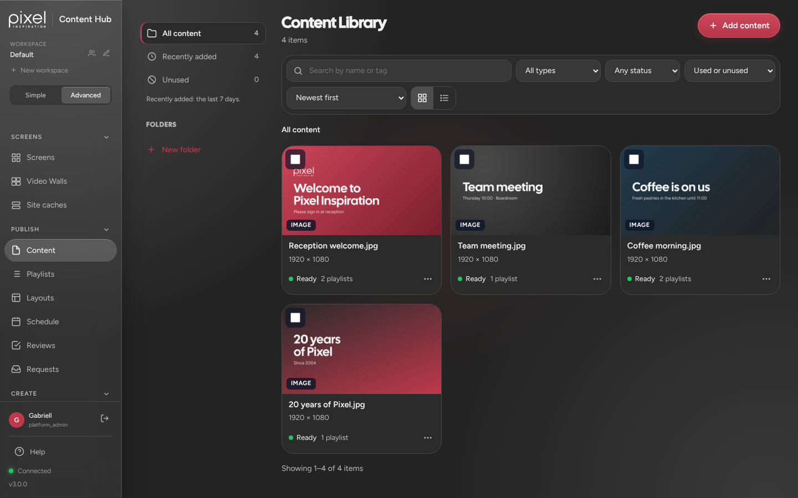
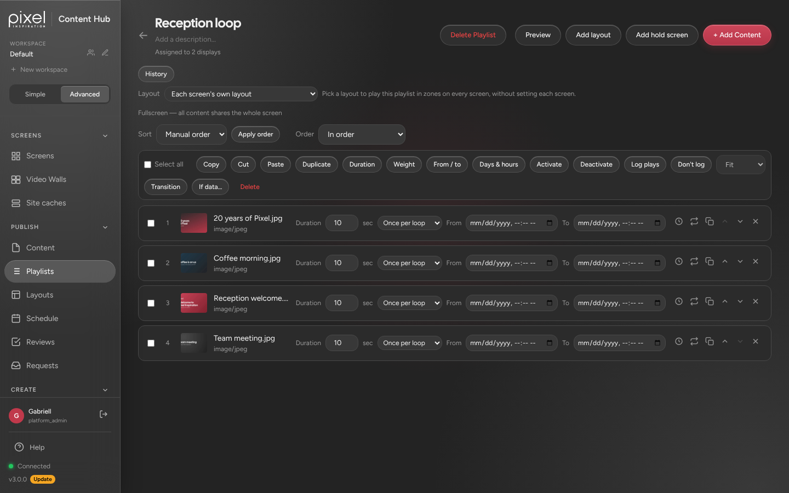
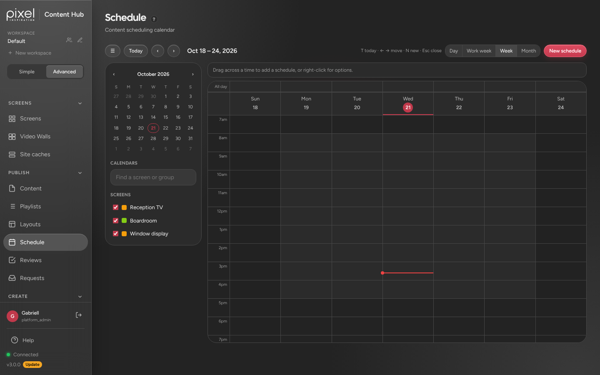
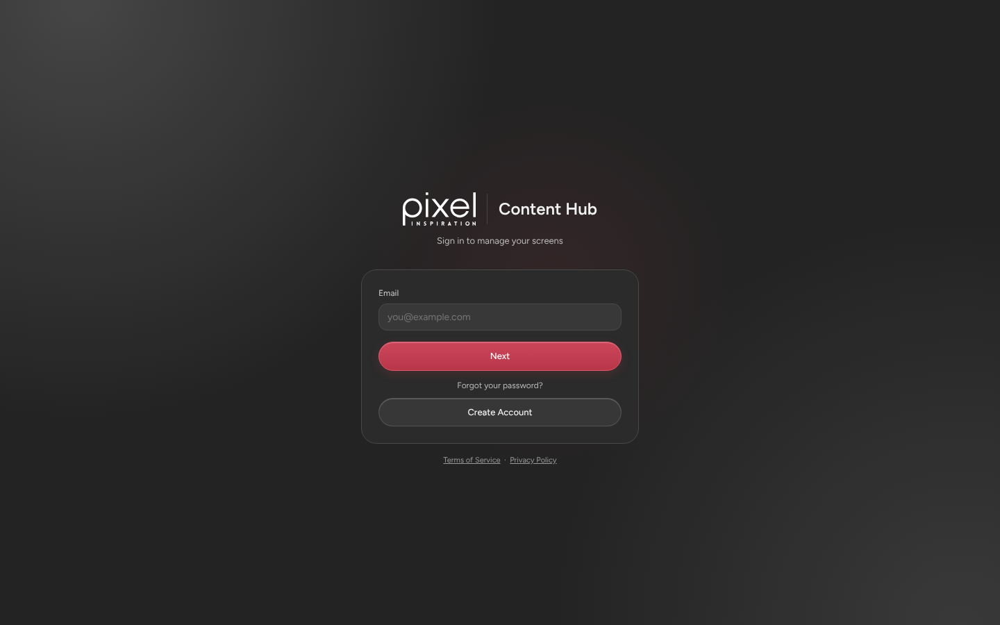

# Pixel Content Hub

Pixel Inspiration's digital signage portal. Upload content, build playlists and schedules, and see what every screen is showing, from one dashboard in the Pixel design language.

  

## What it does

- **Screens:** pair a TV, PC or any browser with a 6-digit code, then see each screen's live preview, health and what it's playing.
- **Content library:** upload images, video, audio and PDFs, or add web pages, YouTube and live streams. Folders, tags and search keep it tidy.
- **Playlists:** put content in running order, set how long each item shows, and give items start and end dates. One playlist can play on many screens.
- **Schedules:** a weekly calendar for what plays when, per screen or per group of screens.
- **Layouts, video walls and widgets:** split a screen into zones, join screens into one wall, and add clocks, weather, tickers and web pages.
- **Simple and Advanced views:** Simple walks new users through the basics; Advanced shows every tool.
- **Web player:** screens open `http://<server>:<port>/player` in a browser. No app to install.

<table>
  <tr>
    <td></td>
    <td></td>
  </tr>
  <tr>
    <td align="center">Content library</td>
    <td align="center">Playlist editor</td>
  </tr>
  <tr>
    <td></td>
    <td></td>
  </tr>
  <tr>
    <td align="center">Schedule</td>
    <td align="center">Sign-in</td>
  </tr>
</table>

## Install

[`docs/pixel-install.md`](docs/pixel-install.md) covers installing, running, updating and removing it on a Linux machine. It runs on port **2004** in its own folder, so it can sit next to an existing ScreenTinker install without touching it.

You need Node.js 22.14 or newer. The first account registered becomes the admin.

## How it differs from ScreenTinker

- **Pixel branding and design.** The dashboard, sign-in page and web player use the Pixel design language: grey glass, the crimson accent, Figtree and Cal Sans, and the Pixel Inspiration "Content Hub" logo. The fonts are served by the portal itself, so it works on a network with no internet.
- **No Support Access.** ScreenTinker's vendor support login is removed from the sign-in page, Settings and the server.
- **No ScreenTinker prompts.** The usage-statistics prompt is hidden, and the sponsor request is turned off with `ST_HIDE_SPONSOR=true`.
- **No in-app "Update Now".** It would install a ScreenTinker release over the Pixel changes. ScreenTinker updates are brought in with git instead.

## Working on it

Read [`CLAUDE.md`](CLAUDE.md) first. It covers the ground rules, how the design language maps onto the dashboard, and how to merge in new ScreenTinker releases. The company design files are in [`design/`](design/).

- `server/`: Node.js server (Express, Socket.IO, SQLite). Run the tests with `cd server && npm test`.
- `frontend/`: the dashboard, served as static files.
- `server/player/`: the web player the screens run.

## Built on ScreenTinker

Pixel Content Hub is built on [ScreenTinker](https://github.com/screentinker/screentinker) 3.0.0, open-source digital signage software, used under the MIT licence ([`LICENSE`](LICENSE)). ScreenTinker's repository has the full feature list, its architecture, the native players for Android, Tizen, webOS, Roku and others, and its own documentation. The upstream docs are also in [`docs/`](docs/) and [`ARCHITECTURE.md`](ARCHITECTURE.md).
